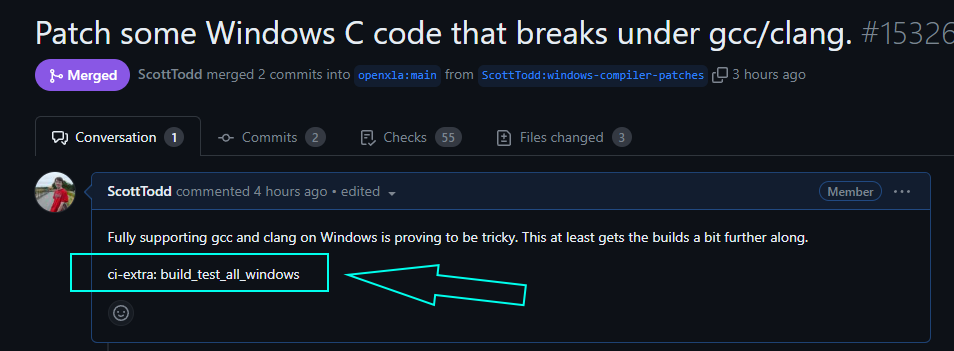
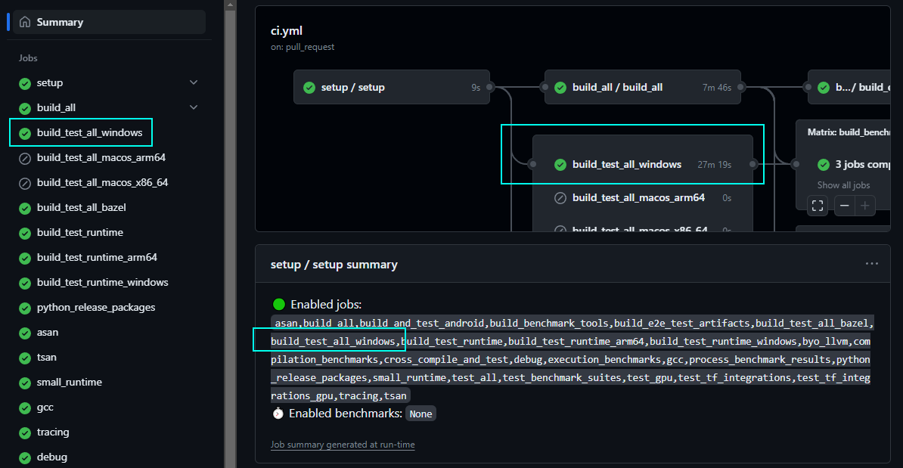

# Contributing to IREE

<!-- Most of this page is included from CONTRIBUTING.md in the repository
     root, which GitHub shows to contributors. Only sections that are not
     relevant to every contributor belong in this file. markdownlint does not
     see the headings of the included sections, hence MD001 is disabled. -->
<!-- markdownlint-disable MD001 -->

--8<-- "CONTRIBUTING.md:intro"

--8<-- "CONTRIBUTING.md:getting-in-touch"

--8<-- "CONTRIBUTING.md:developer-policies"

#### Cryptographically signing commits

_This is the recommended approach for frequent contributors!_

For members of the repository's organization
(see [obtaining commit access](#obtaining-commit-access)), commits that are
signed do not require the `Signed-off-by` text. See these references:

* [Signing commits](https://docs.github.com/en/authentication/managing-commit-signature-verification/signing-commits)
    (generate key, add to <https://github.com/settings/keys>, `git commit -S`)
* [SSH commit signature verification](https://docs.github.com/en/authentication/managing-commit-signature-verification/about-commit-signature-verification#ssh-commit-signature-verification)
    (recommended if you already use SSH keys with GitHub) and
    [Signing Git Commits with SSH Keys](https://blog.dbrgn.ch/2021/11/16/git-ssh-signatures/)
    (streamlined version of the previous page).

    SSH keys can be added at <https://github.com/settings/ssh/new>
    (Note that even if you have added your SSH key as an authorized key, you
    need to add it again as a signing key).

    Then,

    ```bash
    # Sign commits automatically
    git config --global commit.gpgsign true
    git config --global tag.gpgsign true

    # Sign using SSH, not GPG
    git config --global user.signingkey ~/.ssh/id_rsa.pub
    git config --global gpg.format ssh

    # Create an "allowed_signers" file
    echo your@email `cat ~/.ssh/id_rsa.pub` > ~/.ssh/allowed_signers
    git config --global gpg.ssh.allowedSignersFile ~/.ssh/allowed_signers
    ```

* [Generating GPG keys](https://docs.github.com/en/authentication/managing-commit-signature-verification/generating-a-new-gpg-key)
    (alternative to using SSH keys)

    GPG keys can be added at <https://github.com/settings/gpg/new>, then:

    ```bash
    # Sign commits automatically
    git config --global commit.gpgsign true
    git config --global tag.gpgsign true
    ```

### :octicons-people-16: AUTHORS, CODEOWNERS, and MAINTAINERS

The [`AUTHORS` file](https://github.com/iree-org/iree/blob/main/AUTHORS) keeps
track of those who have made significant contributions to the project.

* If you would like additional recognition for your contributions, you may add
  yourself or your organization (please add the entity who owns the copyright
  for your contributions).
* The source control history remains the most accurate source for individual
  contributions.

The
[`MAINTAINERS.md` file](https://github.com/iree-org/iree/blob/main/MAINTAINERS.md)
documents the Technical Steering Committee (TSC) and official maintainers for
project components.

The
[`.github/CODEOWNERS` file](https://github.com/iree-org/iree/blob/main/.github/CODEOWNERS)
designates reviewers for specific components of the project. Maintainers of the
project are assigned as reviewers by default, so that they serve as the first
point of contact and help find a reviewer in case they can't perform the review
themselves.

A strong, recent history of quality commits to a certain part of the project is
generally enough to nominate oneself as a CODEOWNER - subject to maintainer
approval, such participation in the project would be very welcome.

An approval on the PR generally doesn't have to come from a designated code
owner. A single approval by a project member with write access is technically
sufficient to merge the change, however authors of larger PRs that affect
multiple components should allow more time for several code owners and other
project members to review. In such cases, preceding the change with a RFC and
aligning with code owners/maintainers on the design is also a recommended
practice - this allows to minimize time spent in the final PR review stage.

--8<-- "CONTRIBUTING.md:coding-policies"

--8<-- "CONTRIBUTING.md:github-policies"

See our [GitHub Actions documentation](./github-actions.md) for full details.

#### CI behavior manipulation

The setup step of the CI determines which CI jobs to run. This is controlled by
the
[configure_ci.py](https://github.com/iree-org/iree/blob/main/build_tools/github_actions/configure_ci.py)
script. It will generally run a pre-determined set of jobs on presubmit with
some jobs kept as post-submit only. If changes are only to a certain set of
excluded files that we know don't affect CI (e.g. Markdown files), then it will
skip the jobs.

You can customize which jobs run using
[git trailers](https://git-scm.com/docs/git-interpret-trailers) in the PR
description.

The available options are

``` text
ci-skip: jobs,to,skip
ci-extra: extra,jobs,to,run
ci-exactly: exact,set,of,jobs,to,run
skip-ci: free form reason
```

??? info - "Using `skip-ci`"

    `skip-ci` skips all jobs. It is mutually exclusive with the other `ci-*`
    options and is synonymous with `ci-skip: all`.

    ``` text
    skip-ci: free form reason
    ```

??? info - "Using `ci-skip`, `ci-extra`, `ci-exactly`"

    The `ci-*` options instruct the setup script on which jobs to include or
    exclude from its run. They take a comma-separated list of jobs which must be
    from the set of top-level job identifiers in the `ci.yml` file or the
    special keyword "all" to indicate all jobs.

    ``` text
    ci-skip: jobs,to,skip
    ci-extra: extra,jobs,to,run
    ci-exactly: exact,set,of,jobs,to,run
    ```

    * `ci-skip` removes jobs that would otherwise be included, though it is not
    an error to list jobs that would not be included by default.
    * `ci-extra` adds additional jobs that would not have otherwise been run,
    though it is not an error to list jobs that would have been included anyway.
    It *is* an error to list a job in both "skip" and "extra".
    * `ci-exactly` provides an exact list of jobs that should run. It is
    mutually exclusive with both "skip" and "extra".

    In all these cases, the setup does not make any effort to ensure that job
    dependencies are satisfied. Thus, if you request skipping the
    `build_packages` job, all the jobs that depend on it will fail, not be
    skipped.

##### CI configuration recipes

Copy/paste any of these at the bottom of a PR description to change what the CI
runs.

* Skip all CI builds and tests, e.g. for comment-only changes:

    ``` text
    skip-ci: Comment-only change.
    ```

* Only run runtime builds:

    ``` text
    ci-exactly: runtime
    ```

* Only run ONNX tests:

    ``` text
    ci-exactly: build_packages,test_onnx
    ```

* Only run Bazel builds, e.g. for changes only affecting Bazel rules:

    ``` text
    ci-exactly: linux_x64_bazel
    ```

* Opt in to the Linux arm64 build:

    ``` text
    ci-extra: linux_arm64_clang
    ```

* Opt in to the MacOS build and test workflows:

    ``` text
    ci-extra: macos_arm64_clang
    ```

* Other opt in builds:

    ``` text
    ci-extra: linux_x64_clang_byollvm, linux_x64_clang_debug, linux_x64_clang_tsan
    ```

For example, this PR opted in to running the `build_test_all_windows` job
(which was renamed to `windows_x64_msvc`):



The enabled jobs can be viewed from the Summary page of an action run:



--8<-- "CONTRIBUTING.md:github-policies-continued"

### :octicons-git-merge-16: Obtaining commit access

Access to repositories is divided into tiers following the
[GitHub organization permissions model](https://docs.github.com/en/organizations/managing-user-access-to-your-organizations-repositories/managing-repository-roles/repository-roles-for-an-organization):

| Tier | Description | Team links |
| ---- | ----------- | --------- |
Triage | **New project members should typically start here**<br>:material-check: Can be [assigned issues](https://docs.github.com/en/issues/tracking-your-work-with-issues/assigning-issues-and-pull-requests-to-other-github-users)<br>:material-check: Can apply labels to issues / PRs<br>:material-check: Can run workflows [without approval](https://docs.github.com/en/actions/managing-workflow-runs/approving-workflow-runs-from-public-forks) | <ul><li>[iree-triage](https://github.com/orgs/iree-org/teams/iree-triage)<br>(access to most repositories)</li></ul>
Write | **Established contributors can request this access**<br>:material-check: Can [merge approved pull requests](https://docs.github.com/en/pull-requests/collaborating-with-pull-requests/incorporating-changes-from-a-pull-request/merging-a-pull-request)<br>:material-check: Can create branches<br>:material-check: Can [re-run workflows](https://docs.github.com/en/actions/managing-workflow-runs-and-deployments/managing-workflow-runs/re-running-workflows-and-jobs) | <ul><li>[iree-write](https://github.com/orgs/iree-org/teams/iree-write)<br>(access to most repositories)</li><li>[iree-turbine-write](https://github.com/orgs/iree-org/teams/iree-turbine-write)<br>(access to <a href="https://github.com/iree-org/iree-turbine">iree-turbine</a>)</li><li>[iree-fusilli-write](https://github.com/orgs/iree-org/teams/iree-fusilli-write)<br>(access to <a href="https://github.com/iree-org/fusilli">fusilli</a>)</li></ul>
Maintain/Admin | :material-check: Can [edit repository settings](https://docs.github.com/en/repositories/managing-your-repositorys-settings-and-features)<br>:material-check: Can push to [protected branches](https://docs.github.com/en/repositories/configuring-branches-and-merges-in-your-repository/managing-protected-branches/about-protected-branches) | Added case-by-case by the TSC

All access tiers first require joining the
[iree-org GitHub organization](https://github.com/iree-org/). To request
membership in iree-org, send an email to
<iree-github-requests@lists.lfaidata.foundation> with this template:

```text
GitHub username:

Company/organization you are associated with:

Reason for requesting access:
```

<!-- markdownlint-disable-next-line -->
[Send this email template to request access :fontawesome-solid-paper-plane:](mailto:iree-github-requests@lists.lfaidata.foundation?&subject=Requesting%20membership%20in%20iree-org&body=GitHub%20username:%0D%0A%0D%0ACompany/organization%20you%20are%20associated%20with:%0D%0A%0D%0AReason%20for%20requesting access:){ .md-button .md-button--primary }

If approved, an invitation will be sent to your GitHub account. You can also
view the [invitation link](https://github.com/orgs/iree-org/invitation)
directly. Then, once you are a member of the organization, you can request to
join any of the teams on <https://github.com/orgs/iree-org/teams> (note that
some teams are nested under iree-triage, so click the caret to expand the list).

Write access is reserved for "established contributors" who have a track record
of multiple high quality pull requests or reviews and have demonstrated
familiarity with the contributing guidelines.

!!! question "Questions about access"

    For questions about access policies, feel free to reach out on the
    [`#github` channel](https://discord.com/channels/689900678990135345/1166024193599615006)
    on IREE's Discord server, the <iree-github-requests@lists.lfaidata.foundation>
    email list, or another of our
    [communication channels](../../index.md#communication-channels) to discuss.

### :octicons-git-branch-16: Branch naming

Most work should be done on
[repository forks](https://docs.github.com/en/pull-requests/collaborating-with-pull-requests/working-with-forks/about-forks).
For developers with write access, when creating a branch in the common
[iree-org/iree repository](https://github.com/iree-org/iree), please follow
these naming guidelines:

Branch type | Naming scheme | Example
-- | -- | --
Single user | `users/[username]/*` | `users/cooldeveloper/my-awesome-feature`
Shared feature branch | `shared/*` | `shared/pytorch-performance-sprint`
Dependency updates | `integrates/*` | `integrates/llvm-20240501`

Branches that do not meet these guidelines may be deleted, especially if
they [appear to be stale](https://github.com/iree-org/iree/branches/stale).

## Tips for contributors

### Tool recommendations

| Program or tool | Description |
| -- | -- |
[:material-microsoft-visual-studio-code: Visual Studio Code (VSCode)](<https://code.visualstudio.com/>) | The most commonly used editor amongst IREE developers
[:simple-cmake: Ccache](<https://ccache.dev/>) | A fast C/C++ compiler cache. See the [CMake with `ccache`](../building/cmake-with-ccache.md) page
[:simple-github: GitHub CLI](<https://github.com/cli/cli>) | A CLI for interacting with GitHub
[:simple-github: "Refined GitHub" browser extensions](<https://github.com/sindresorhus/refined-github>) | Extension that add features to the GitHub UI

### :material-hammer-wrench: Build systems

IREE supports building from source with both Bazel and CMake.

* CMake is the preferred build system and offers the most flexible
  configuration options
* Bazel is a stricter build system and helps with usage in Google's downstream
  source repository
* Certain dependencies (think large/complex projects like CUDA, TensorFlow,
  PyTorch, etc.) may be difficult to support with one build system or the
  other, so the project may configure these as optional
